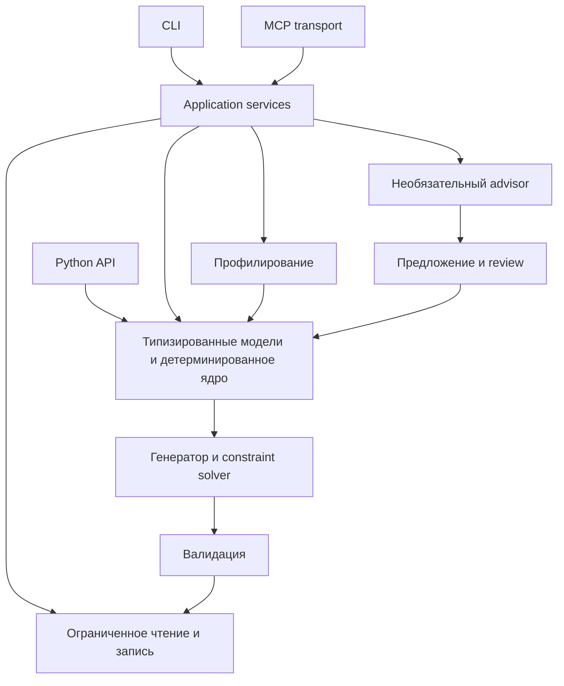

# Архитектура и точки расширения

[English](../agent_design.md) · Русский

## Как проходит запрос



| Зона | Реальные модули | Ответственность |
| --- | --- | --- |
| Контракты | core/dataset.py, entity.py, field.py, settings.py | Pydantic-модели DatasetProfile и DatasetSpec, ссылки и настройки |
| CSV-профиль | profiling/schema_profiler.py, relationship_profiler.py, constraint_miner.py, cache.py | Потоковый анализ, ограниченная выборка, гипотезы, кеш метаданных |
| Генерация | generation/planner.py, entity_generator.py, constraint_solver.py | Spec из профиля, новые значения, согласование ограничений |
| Проверка | validation/schema_validator.py, relationship_validator.py, constraint_validator.py, reconciliation.py | Секции отчёта и обязательные post-solve guards |
| CLI | cli.py, cli_parser.py, cli_presenter.py, cli_contract.py | Разбор, dispatch, безопасное представление, коды завершения |
| Базы | postgres_config.py, postgres_client.py, postgres_profiler.py; trino_config.py, trino_client.py, trino_profiling.py | Scope, read-only доступ, агрегаты и бюджеты |
| Query source | sql_query_source.py, sql_query_profiling.py, sql_query_adapters.py | Локальный AST, allowlists, no-row/aggregate-only профиль |
| MCP | mcp_generator_transport.py, mcp_trino_transport.py и соответствующие server.py | Ограниченный транспорт и регистрация инструментов |
| Публикация | io/workflows.py, io/artifacts.py, workspace_store.py | Выходные артефакты, staging, workspace |
| Advisor | advisor.py и provider adapters | Ограниченные предложения по метаданным без auto-approval |

Все пути в таблице — внутри `src/test_data_agent/`. I/O и provider adapters не должны подменять детерминированное ядро. Семена, бюджеты и зависимости передаются явно.

## Минимальный Python API

В активном окружении из корня checkout выполните этот локальный пример; он не читает источник и не печатает строки:

```python
from test_data_agent import DatasetSpec, generate_dataset, validate_dataset

spec = DatasetSpec.model_validate({
    "schema_version": "1.1",
    "entities": [{
        "name": "checks", "row_count": 3,
        "primary_key": "check_id",
        "fields": [{"name": "check_id", "data_type": "integer", "is_identifier": True}],
    }],
})
rows = generate_dataset(spec, seed=12345)
assert len(rows["checks"]) == 3
assert validate_dataset(rows, spec).valid
print("python API: ok")
```

Предварительно нужен установленный базовый пакет. Ожидается `python API: ok`; при ошибке проверьте Python/package version и схему. Пример проверен в аудите; подробности окружения — [отчёт](quality-report.md). Эта операция возвращает строки вызывающему Python-коду, поэтому вывод в чат/лог по умолчанию недопустим. Безопасный признак завершения — сводка assert, а для сохранения файлов используйте документированный bundle workflow.

Подробные карты: [Application boundaries](../reference/application-boundaries.md), [описание проекта](agent_design.md). Карта исходных модулей также хранится в `docs/implementation_map.md` (служебный файл исключён из сайта).

## Дополнения 1.6.0

`core/distribution.py` и `core/decimal_units.py` задают exact DECIMAL; DatasetSpec 1.1 переносит embedded business_rules. `io/transformation_batch_workflow.py`, `transformation_batch_profile.py`, `transformation_query_workflow.py` координируют отдельную mixed-origin обработку, фиксированные snapshots и local receipt consumption. CLI registration находится в cli_parser.py и cli_transformation_candidate.py; running generator MCP регистрирует соответствующие consumers. Внутреннее имя candidate не означает отсутствие публичной команды. Расширение публичного Python API из внутренних helpers не следует: проверяйте __all__ и contract fixtures.
