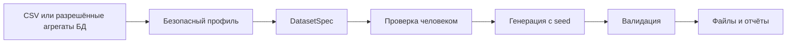

# Профили и спецификации

[English](../../concepts/profiles-and-specs.md) · Русский

Профиль описывает наблюдаемую структуру и ограниченные агрегаты источника; DatasetSpec задаёт исполняемый проверенный контракт. Generation использует spec, а не исходные строки. Профиль может содержать nullable/distinct/length/distribution evidence и кандидаты связей, но не source rows, PII или secrets.

Новые DatasetSpec используют 1.1, legacy 1.0 поддерживается без decimal. Import payload без версии трактуется как 1.0, новый Python DatasetSpec по умолчанию — 1.1. Укажите версию явно.

SQL query-source policy 1.1 допускает ограниченный single-table SELECT, scalar expressions и aliased SUM/COUNT/MIN/MAX/AVG с ограниченным GROUP BY. JOIN/CTE/subqueries/windows/HAVING/неизвестные функции отклоняются. Профиль хранит fingerprint, а не SQL text или result rows. has_unmodeled_expressions=true (в том числе aggregate) блокирует automatic infer-spec: напишите независимо проверенный spec. Direct column aliases могут выводиться автоматически; старые query profiles без marker нужно получить заново.

Практика: [раздельный процесс](../getting-started/related-tables.md), [поля DatasetSpec](../dataset_profile_and_spec.md), [конфигурация](../reference/configuration.md).

Проект создаёт новые синтетические данные для тестирования программ. Он анализирует структуру CSV или разрешённые агрегаты базы, составляет `DatasetSpec`, генерирует значения и проверяет результат. Исходные строки не копируются в результат.

Например, команде разработки нужны 25 заказов с корректными ссылками на покупателей, но реальные покупатели не должны попадать в тестовую среду. Можно использовать вымышленный CSV, проверить выведенную спецификацию и получить новый набор с явным `seed`.

Проект подходит для воспроизводимых тестовых фикстур, проверки схем, связей и формализованных бизнес-правил. Он не гарантирует полную статистическую точность исходного набора, анонимность, юридическое соответствие или сохранение всех правил предметной области.

AI-сервис необязателен. Он может предложить изменения спецификации; генерацию и проверки выполняет детерминированный код.

Далее: [возможности](choosing-an-approach.md), затем [установка](../getting-started/installation.md).

## Термины

| Термин | Значение |
| --- | --- |
| Синтетические данные | Новые значения, созданные генератором по спецификации |
| CSV | Текстовая таблица с заголовком и разделителями |
| Сущность / entity | Одна таблица; обычно имя CSV без расширения |
| Поле / field | Один столбец таблицы |
| Профиль / DatasetProfile | Метаданные: типы, количества, диапазоны, распределения и кандидаты связей |
| DatasetSpec | Проверяемый контракт генерации и валидации, YAML или JSON |
| DECIMAL | Точное десятичное число с precision (числом цифр) и scale (числом дробных разрядов) |
| Mixed-origin | Артефакт трансформации с происхождением ячеек replacement/synthetic/original; не является целиком synthetic |
| Receipt | Локальное подтверждение сохранения значений, привязанное к точному snapshot; выдаётся человеком в управляющем терминале |
| Seed | Начальное число локального генератора случайных значений |
| Детерминированность | Повтор результата при одинаковых входах, seed и окружении |
| Primary key | Поле уникального идентификатора строки |
| Foreign key | Ссылка дочерней строки на ключ родительской таблицы |
| Distribution | Правило распределения значений: например категории или числовой диапазон |
| Constraint | Структурированное ограничение, например порядок дат или формула |
| Manifest | `generation_manifest.json`: сведения о генерации, seed, проверках и окружении |
| Валидация | Проверка результата по заданным правилам |
| PII | Personally Identifiable Information: персональные и позволяющие идентификацию данные |
| Allowlist | Явный список разрешённых объектов или полей |
| CLI | Command-line interface: команды в терминале |
| MCP | Model Context Protocol: протокол вызова инструментов клиентом |
| Advisor | Необязательный AI-провайдер, предлагающий изменения spec |
| Workspace | Выделенная рабочая папка артефактов |
| SHA-256 / fingerprint | Отпечаток точного содержимого; изменение файла меняет отпечаток |
| Extra | Необязательная группа зависимостей Python-пакета |
| Exit code | Числовой код завершения команды; проверяется автоматизацией |

`confidence` — оценка уверенности, `status` — статус предположения. Они не превращают найденную связь в доказанный закон предметной области. `unique_ratio_kind=lower_bound` означает нижнюю границу уникальности, а не точную долю.

Далее: [требования](../getting-started/installation.md).

## Границы дат и времени

В проверенной спецификации `date_range` и `datetime_range` задают границы
генерации. Пропущенные границы заменяются на 2020-01-01 и 2025-01-01.
Для более раннего или позднего периода укажите обе границы в правильном
порядке: частичная граница, противоречащая значению по умолчанию, теперь
вызывает отказ с подсказкой. Прежние выходные файлы при этом сохраняются.

Смещение времени по-прежнему выбирается с точностью до целой секунды и
сохраняет микросекунды нижней границы. Для длинных интервалов используется
целочисленная длительность, чтобы не выйти за максимум при округлении.
Минимум и максимум не доказывают месячную или иную календарную гранулярность;
соответствие периодам источника остаётся неизмеренным.
