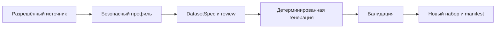

# Рабочий процесс от источника к набору

[English](../domain_agnostic_workflow.md) · Русский

Единый контракт — DatasetSpec. CLI, Python, MCP и approved agent workflow используют проверяемые модели вместо генерации строк языковой моделью.

1. Выберите адаптер источника и конечные бюджеты. CSV/Parquet читаются локально; PostgreSQL/Trino — read-only в согласованном scope.
2. Получите metadata и агрегаты без переноса строк в output. Неизвестные факты остаются неизвестными.
3. Выведите или напишите spec: типы, nullable, identifiers, распределения, связи, count, seed и правила.
4. Review проверяет соответствие домену и безопасность; advisor может предложить гипотезу, но не принять её.
5. Генератор создаёт новые значения, применяет ограничения и проверяет их перед публикацией.
6. Примите набор после проверки manifest, validation и бизнес-инвариантов.

Для нового домена используйте раздельные этапы из [связанных таблиц](getting-started/related-tables.md). Сокращённая команда CSV подходит известной вымышленной фикстуре. Примеры DECIMAL и Parquet находятся в [матрице форматов](reference/source-output-matrix.md).

Selective transformation имеет отдельный mixed-origin контракт и не включается в этот source-free pipeline. SQL query-source profiling и capture rows для transformation session также различаются по разрешениям и рискам.
